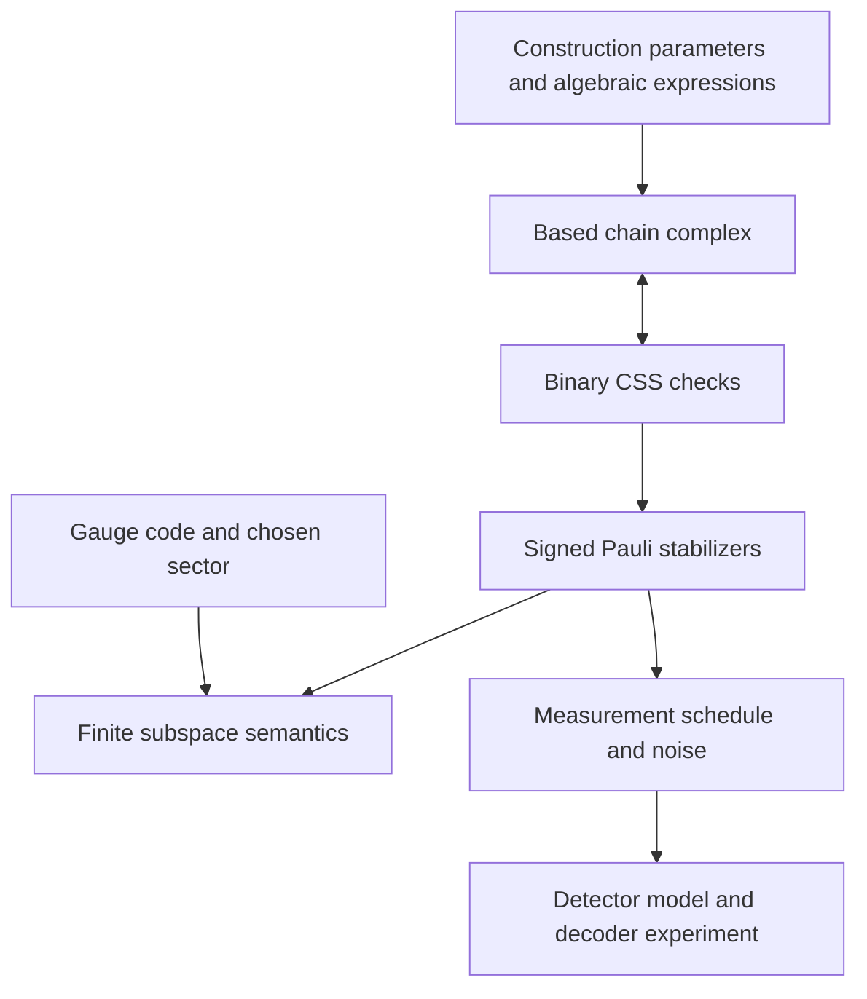

# Representation and lowering design

QECLang separates **code semantics**, **structured constructions**, **finite instances**, and **experiments**. A code does not determine its noise process, decoder, measurement circuit, or hardware layout. These should be composable objects with explicit compatibility checks.

## What defines a code?

For a finite subspace code, specify the physical tensor factors and either a code projector or an encoding isometry. The tensor factors matter: the same abstract subspace with a different factorization has a different notion of locality and error weight. An isometry also chooses the logical basis; a projector does not. Noise and recovery are additional inputs to a correction problem. Exact correction of Kraus errors satisfies the Knill–Laflamme condition `V† E_a† E_b V = c_ab I`. [Knill and Laflamme](https://arxiv.org/abs/quant-ph/9604034).

A subsystem code additionally identifies the protected logical factor and an unprotected gauge factor. Finite-dimensional logical operator algebras permit direct sums of such sectors, including classical labels. This is a broad semantic interface, not an efficient matrix format. [Kribs et al.](https://arxiv.org/abs/quant-ph/0504189), [Dauphinais, Kribs, and Vasmer](https://arxiv.org/abs/2304.11442).

There is no intrinsic number of implementation classes that mathematics requires. The following six dialects are an engineering partition by available algorithms, with overlap and refinement between them:

| Dialect | Defining data | Main obligation | Initial scope |
|---|---|---|---|
| Finite subspace/algebra | Physical factors; projector/isometry; logical algebra or gauge decomposition | Isometry/projector and algebra identities | Dense isometry/KL oracle and separately composed finite CPTP channels (optional NumPy) |
| Pauli stabilizer | Local dimension; signed generators; physical ordering | Commutation and exclusion of `-I` | Binary qubits |
| CSS/chain | Based spaces and two binary boundary matrices | Consecutive boundaries compose to zero | Packed CSS/chains and validated sparse CSS |
| Pauli subsystem | Gauge row space; chosen center sector when a concrete embedding is needed | Center, gauge rank and logical quotient | Gauge module with explicit or chosen signed center sector |
| Bosonic/continuous-variable | Modes, operator/lattice description, energy/analytic domain | Normalizability and operator-domain or approximation assumptions | Planned |
| Dynamical/instrument | Ordered preparations, measurements, feedforward, boundaries, logical transport | Temporal consistency and declared noise semantics | Planned |

The binary CSS constructor fixes all listed pure-X and pure-Z checks to their positive eigenspaces. Its two matrices and their explicit shapes determine the finite code. Signed CSS sectors could be added later. For qLDPC **families**, also specify the family parameter, construction rule, and bounds on both check weight and checks per qubit, uniformly in blocklength. Small density of one finite matrix is not an asymptotic LDPC certificate.

A signed stabilizer representation is necessary because commuting support rows can multiply to `-I`. The implementation uses `i^phase X^x Z^z`, including the phase incurred when multiplying Paulis. Parameters depend on support rank; the actual common eigenspace also depends on signs. [Gottesman](https://arxiv.org/abs/quant-ph/9705052).

For a gauge space `G` in binary symplectic coordinates, its center is `S = G ∩ G⊥`. Write `g = dim G` and `s = dim S`; the number of gauge qubits is `(g-s)/2`, and the protected count is `n-(g+s)/2`. Dressed logical operators belong to `S⊥ / G`, while bare logical operators belong to `G⊥ / S`. Dropping the gauge structure changes the protected subsystem. [Poulin](https://arxiv.org/abs/quant-ph/0508131).

A static gauge group cannot stand in for all measurement protocols. Floquet constructions can encode information through their ordered measurement pattern even when the associated static subsystem code has no logical qubits. [Hastings and Haah](https://arxiv.org/abs/2107.02194). Bosonic codes likewise require an analytic dialect; truncation is an approximation with an error obligation, not an exact binary lowering. [Gottesman, Kitaev, and Preskill](https://arxiv.org/abs/quant-ph/0008040).

## Layers and preservation contracts

The chain/CSS conversions, CSS-to-stabilizer conversion, and guarded numerical stabilizer-to-isometry lowering are implemented. The abelian group-algebra layer lowers to binary operators. The full provenance-bearing expression graph and temporal compilation remain planned. Schedule synthesis also needs ancillas, gate choices, ordering, and a fault model; it is not uniquely determined by the code.

| Transformation | Preserved | Cost or information lost |
|---|---|---|
| Based binary chain ↔ positive CSS | `n`, `k`, X/Z logical quotients, Hamming metric | Only a transpose and a convention change |
| CSS → signed stabilizer | Physical code, logical count and Pauli distance | CSS structure should remain available as provenance |
| Symbolic circulants → binary blocks | Operator action under declared ordering | Size increases with lift order; symbolic symmetry can be lost |
| Stabilizer → dense projector | Physical subspace | Exponential storage; retain generator provenance |
| Row reduction | Row space and rank | Generator weights and measurement presentation can change |
| Arbitrary basis change in a complex | Abstract homology | Hamming weight and distance need not survive |
| Gauge fixing | A selected code/subsystem relationship | Requires an explicit fixing choice; not identity lowering |
| Bosonic truncation | Only specified approximate properties | Requires cutoff, norm/energy assumptions, and error estimates |

Permuting physical qubits preserves Hamming weight. An arbitrary invertible linear map on chain coordinates need not correspond to such a permutation. Consequently, an optimizer must track metric preservation separately from algebraic equivalence. Never silently replace a sparse measurement presentation with its dense reduced basis.

Implemented CSS transformations include qubit permutation, Hadamard duality, and independent-check reduction. A validated chain map carries three degree maps and can compute its induced homology action. A quasi-isomorphism preserves homology dimensions; it does not by itself preserve distance or yield a physical encoding circuit.

Finite lifted-product records and cyclic Laurent-family manifests now preserve ring seeds, parameter domains, action/ordering conventions, and construction fingerprints. Family locality bounds use pre-specialization monomial counts. Structured parameter results retain the selected backend, assumptions, evidence, and explicit unsupported/budget states. A future uniform lowering result should extend those contracts to all transformations and carry a verifier for each preserved invariant. Its status should distinguish exact algebraic identities, theorem applications with checked hypotheses, numerical evidence, and conjectures. A Python test is not a formal proof of a theorem for every family member.

## Technology decision

Start with an inspectable Python library and exact binary arithmetic. Packed integer rows implement XOR, parity, and elimination without floating-point rank errors. They are a compact reference backend with machine-word parallelism, not a claim of optimal large sparse linear algebra. Sparse input can become dense during elimination; transposition and Kronecker expansion can dominate memory. Performance work must measure that boundary. `SparseBinaryMatrix` separately stores sorted support rows with O(rows + nonzeros) index storage; COO duplicate entries cancel over GF(2). Sparse syndrome products and decoder adjacency use this representation directly. General sparse matrices still require an explicit exact-analysis backend; sparse storage alone is not a sparse-rank algorithm. Structured cyclic and odd-abelian ring matrices additionally have exact algebraic rank backends that avoid full binary expansion. Mixed-order abelian analysis retains regular two-primary components; those are full size for pure two-groups. Construction analysis and CLI select each backend explicitly. Mixed-order abelian analysis retains bounded regular components for the power-of-two subgroup; a pure 2-group still requires a full-size component.

The implemented symbolic layer retains sparse monomial support for the GF(2) group algebra of finite products of cyclic groups, with exact addition, multiplication, involution, ring matrices, block/Kronecker operations, and guarded regular-representation expansion. The commutative lifted product shares one group coordinate across the factors. Typed construction/family manifests cover those implemented forms; a general construction-expression DAG remains future work. Noncommutative rings need explicit left/right module actions and an involution; ordinary commutative polynomial multiplication is insufficient for general lifted products.

| Candidate | Decision | Reason |
|---|---|---|
| Python + sparse/packed GF(2) | Core | Exact support and packed backends with explicit conversion; suitable reference oracle |
| NumPy/SciPy/CVXPY | Optional numerical analysis | Finite channels, sparse interchange, MILP and fixed-encoder recovery SDP; ordinary floating rank is not binary rank |
| SageMath/GAP | Optional symbolic adapter | Finite fields, groups, modules, polynomial quotients; avoid a mandatory heavyweight runtime |
| Rust/C++ with packed sparse/dense kernels | Profile-driven extension | Accelerate elimination and batches without changing semantics |
| MLIR/custom compiler | Defer | Introduce only after rewrite rules, target kernels, and measured bottlenecks stabilize |
| GPU DSL | Later backend for batches | Useful for suitable kernels; does not remove exponential distance-search complexity |
| Lean | Implemented small checker | CSS syndrome/nonmembership soundness and concrete witness replay; broader proof coverage remains separate |

TileLang exposes tile-level programming and compiler passes; CUTLASS and DeepGEMM specialize high-performance GPU linear algebra. Their transferable lesson here is a narrow semantic contract with several implementations. Their numerical execution model is not directly a QEC construction language. [TileLang](https://tilelang.com/), [CUTLASS](https://docs.nvidia.com/cutlass/latest/), [DeepGEMM](https://github.com/deepseek-ai/DeepGEMM).

SageMath integrates symbolic and numerical packages, including GAP. An adapter can exchange finite field and group presentations without making them the core serialization format. [SageMath](https://www.sagemath.org/). Lean checks the current CSS parity-witness theorem and concrete literal replays; Python parsing and translation remain outside that proof. [Lean documentation](https://lean-lang.org/learn/).

There is no blanket zero-cost claim: object construction, validation, representation expansion, and backend conversion cost time and memory. The design target is to amortize these costs, expose them, and preserve enough structure to avoid unnecessary expansion.

## Sparse execution and portable evidence

`SparseCSSCode` validates commutation from sparse incidences under an explicit work budget and exposes syndromes/locality without triggering rank analysis. Direct group-ring sparse lowering feeds this representation and sparse BP. `CSSLogicalFrame` separates the complete logical pairing information needed for simulation from its expensive production. A portable frame record includes exact rank certificates establishing the logical count plus paired, commuting logical representatives. Import verifies those identities against sparse source rows without elimination or full source lowering; producer-side packed analysis remains explicit.

Generic binary rank certificates use `A=UV`, `WU=I`, and `VZ=I`. Logical certificates use zero syndrome and an odd pairing with a separating dual. These are independently checked exact Python evidence; only the CSS parity/zero-syndrome portion currently has a Lean theorem. Polynomial operation traces provide a different replay contract. None of these certificates asserts optimal logical weight, code novelty, or equivalence classification. See [evidence](evidence.md), [formal scope](formal.md), and [family contracts](structured_families.md).

SQLite studies persist deterministic random/mutation proposals, typed seeds, bounded evaluations, provenance, and conservative Pareto objectives. They provide restartable experiments over a restricted scalar cyclic domain; they are not a general compiler or autonomous theorem prover. Their cache is keyed by construction/evaluation semantics, not by physical-code equivalence. [Study contracts](search_studies.md) specify the transactional and computational limits.

## Finite channels and recovery scope

`KrausChannel` represents a finite CPTP map independently of a code. It validates the trace-preserving Kraus sum numerically, retains rectangular input/output dimensions, and supplies composition, tensor products, and explicit input-major Choi conversion. Choi validation never repairs data; conversion permits bounded symmetrization or negative-eigenvalue clipping only when explicitly requested and reports the change. Trace preservation is rechecked rather than normalized. These conventions are detailed in [finite channels](channels.md).

A recovery objective must identify the protected input state and output space. The optional `sdp` backend implements recovery for a fixed subspace isometry or fixed CPTP encoding channel, using maximally mixed logical input and recovery directly to the logical space. `prepare_encoding` converts a subsystem isometry plus an explicit gauge density into the channel `ρ ↦ V(ρ⊗σ)V†`, retaining gauge diagnostics and any requested bounded repair. An unprepared gauge subsystem is rejected; optimizing for this fixed preparation does not protect arbitrary gauge inputs. Primal and dual solves return separate feasibility diagnostics and a numerical gap; raw Choi candidates are retained without implicit repair. See [recovery contracts](recovery.md). It has a dense Choi matrix of dimension received-dimension times logical-dimension. This semantic extension does not provide a sparse decoder, an extraction schedule, or a circuit-level threshold estimate.

The CSS distance portfolio composes verified heuristic/solver upper witnesses with exhaustive-layer lower bounds, preserving numerical solver bounds separately. Sparse BP treats prior probabilities zero and one as exact fixed bits and propagates them before message passing; variable/check/edge budgets are checked before graph allocation. See [distance evidence](distance_portfolio.md), [decoder contracts](decoding.md), and [encoding preparation](encoding.md).
